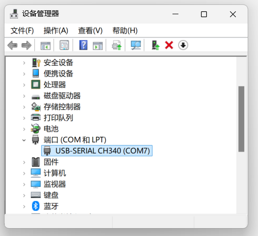
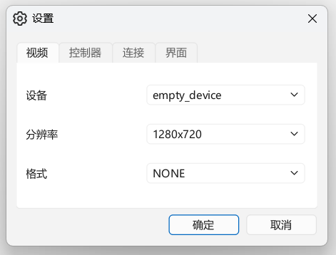
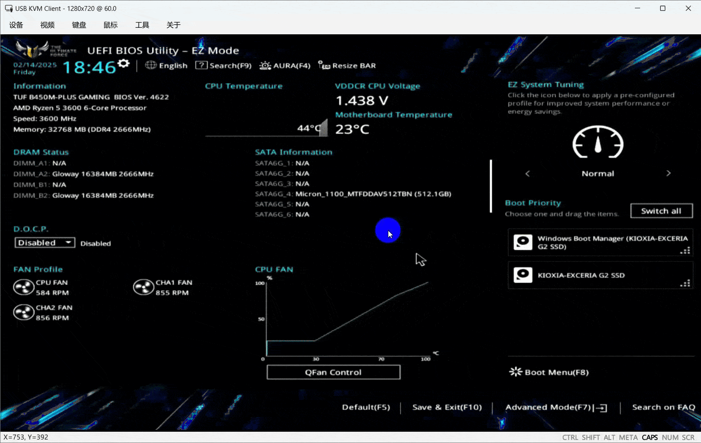
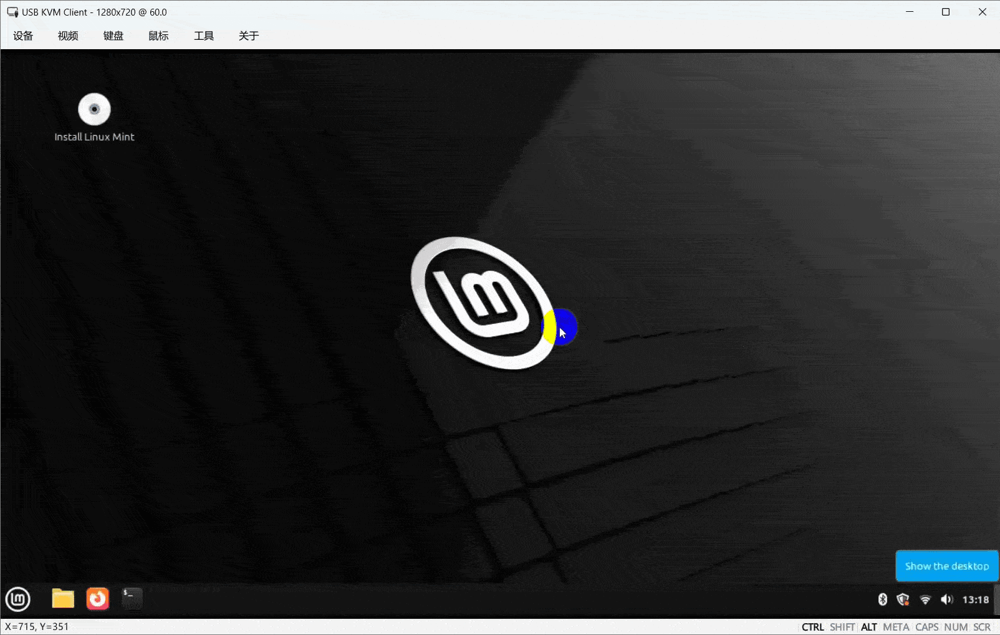

# KVM over USB

[](https://www.python.org)
[](https://github.com/astral-sh/uv)
[](https://github.com/psf/black)
[](https://github.com/wevsty/KVM-over-USB/actions/workflows/code_checks.yml)
[](https://github.com/wevsty/KVM-over-USB/releases)

一个简单、开源的 KVM-over-USB 解决方案。

📖 英文文档 (English version)：[README.md](https://github.com/wevsty/KVM-over-USB/blob/main/documents/EN/README.md)

## 目录

- [简介](#简介)
- [功能特性](#功能特性)
- [硬件部分](#硬件部分)
- [软件](#软件)
- [使用说明](#使用说明)
- [FAQ](#faq)
- [感谢](#感谢)

## 简介

服务器因网络故障等原因失去连接后，要恢复其正常运行往往十分困难。虽然 IPMI 等带外管理技术可以解决此类问题，但这类设备通常价格昂贵，普通用户难以承担。

本项目提供了一些基于 USB 的低成本 KVM 方案：只需一台普通 PC，通过 USB 连接到目标服务器，即可像操作本地键盘、鼠标、显示器一样对服务器进行远程管理与维护。本方案尤其适合家庭用户或小型实验室环境使用。

## 功能特性

- 通过 USB 实现对目标设备的键盘、鼠标与显示控制。
- 支持视频采集设备（摄像头 / 采集卡）画面显示。
- 支持快速输入、自动输入以及剪贴板粘贴。
- 支持发送组合快捷键（如 `Ctrl + Alt + Delete`）。
- 支持 CH9329、KVM-Card-Mini、ESP32-S3 等多种硬件。
- 提供多语言，多平台支持。

## 硬件部分

本项目软件已支持 CH9329、KVM-Card-Mini、ESP32-S3 等相关产品，用户可根据自身需求与预算选择合适的硬件。

> [!NOTE]
> 本项目将尽力保持不同硬件之间体验一致，但受限于硬件本身能力，部分功能可能受限。

### CH9329 系列

详情参见文档：[CH9329 系列](https://github.com/wevsty/KVM-over-USB/blob/main/documents/CN/CH9329_series.md)

### KVM-Card-Mini 系列

详情参见文档：[KVM-Card-Mini 系列](https://github.com/wevsty/KVM-over-USB/blob/main/documents/CN/KVM-Card-Mini_series.md)

### ESP32 系列

详情参见文档：[ESP32 系列](https://github.com/wevsty/KVM-over-USB/blob/main/documents/CN/ESP32_series.md)

## 软件

项目客户端基于 [KVM-Card-Mini-PySide6](https://github.com/ElluIFX/KVM-Card-Mini-PySide6) 的源码进行了改动与重构，并适配了 CH9329 作为键盘鼠标输入使用。

### 预编译客户端

请通过 [Releases 页面](https://github.com/wevsty/KVM-over-USB/releases) 获取预编译客户端。

### 自行编译客户端

编译前请确保已安装以下依赖：

- `git`
- `python`
- `uv`

然后执行以下命令：

```powershell
git clone https://github.com/wevsty/KVM-over-USB.git
cd client
uv venv
uv sync
# 请根据实际环境修改 compiler.ps1 后执行
./compiler.ps1
```

## 使用说明

### Windows

#### 1. 连接硬件

将硬件通过 USB 连接至计算机。

> [!NOTE]
> 如果使用的 USB 转串口芯片为 CH340/CH343 等，请先安装对应的驱动程序：
>
> CH340系列驱动：<https://www.wch.cn/downloads/CH341SER_EXE.html>
> CH343系列驱动 https://www.wch.cn/downloads/ch343ser_exe.html
> 驱动安装成功后可通过「设备管理器」查看串口端口号。
> 

注：如果您使用的是 **KVM-Card-Mini 系列** 硬件，连接到电脑后无需安装任何驱动，即插即用。

#### 2. 配置并连接

1. 打开客户端，选择「设备」菜单 →「设置」。
2. 选择视频摄像头及控制器设备。
3. 点击「确定」保存配置。



配置完成后，通过「设备」菜单 → 「连接」即可开始使用。

### Linux

客户端目前已支持 Ubuntu 等常见 Linux 发行版。

> [!IMPORTANT]
> 在 Linux 下使用前需要关注权限问题。

以 KVM-Card-Mini 为例，使用前需设置 HID 设备访问权限或授予程序 root 权限。
建议设置 udev 规则允许任何用户访问 KVM-Card-Mini 提供的 HID 设备：

```bash
sudo -s
cat > /etc/udev/rules.d/99-kvm-card-mini.rules << EOF
# KVM Card Mini
SUBSYSTEM=="usb", ATTRS{idVendor}=="413d", ATTRS{idProduct}=="2107", MODE="0666"
KERNEL=="hidraw*", ATTRS{idVendor}=="413d", ATTRS{idProduct}=="2107", MODE="0666"
EOF
udevadm control --reload-rules
udevadm trigger
```

执行完成后，重启或者重新插拔设备即可生效。

### macOS

本项目已初步支持 macOS，但尚未经过测试，暂不提供编译好的二进制文件。

如需在 macOS 上使用，请自行从源码自行编译运行。

## 演示

控制 ASUS BIOS：



自动输入功能：



## FAQ

<details>
<summary><b>Q: 如果遇到客户端出现bug应该怎么办？</b></summary>

A: 可以在菜单中启用调试模式，并在 issues 中描述问题并提交调试模式下的日志以供分析问题。

</details>

<details>
<summary><b>Q: 为什么被控制端为 Linux 发行版时鼠标不工作？</b></summary>

A: 部分操作系统不支持鼠标使用绝对坐标模式，请尝试切换至相对坐标模式进行操作。

</details>

<details>
<summary><b>Q: 如何发送 Ctrl + Alt + Delete 一类的组合键？</b></summary>

A: 如需向被控制端发送这些组合键，建议使用「键盘」菜单中的快捷键功能。

</details>

<details>
<summary><b>Q: 使用软件时出现输入异常情况怎么办？</b></summary>

A: 请使用软件「设备」菜单中的重载或重置功能；如使用后依然存在故障，建议尝试重启被控制端的操作系统。

</details>

<details>
<summary><b>Q: 快速粘贴或剪贴板输入时大小写不正确如何处理？</b></summary>

A: 请先通过菜单中的「同步指示器」功能同步键盘状态，再重新尝试。

</details>

## 感谢

- [Jackadminx](https://github.com/Jackadminx) / [KVM-Card-Mini](https://github.com/Jackadminx/KVM-Card-Mini)
- [ElluIFX](https://github.com/ElluIFX) / [KVM-Card-Mini-PySide6](https://github.com/ElluIFX/KVM-Card-Mini-PySide6)
- [binnehot](https://github.com/binnehot) / [KVM-over-USB](https://github.com/binnehot/KVM-over-USB)