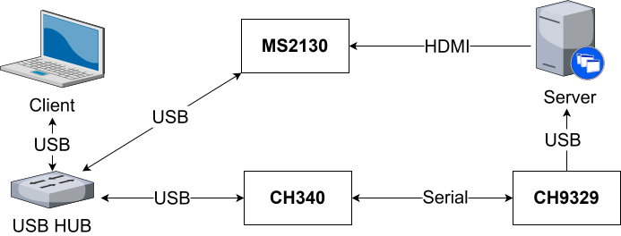
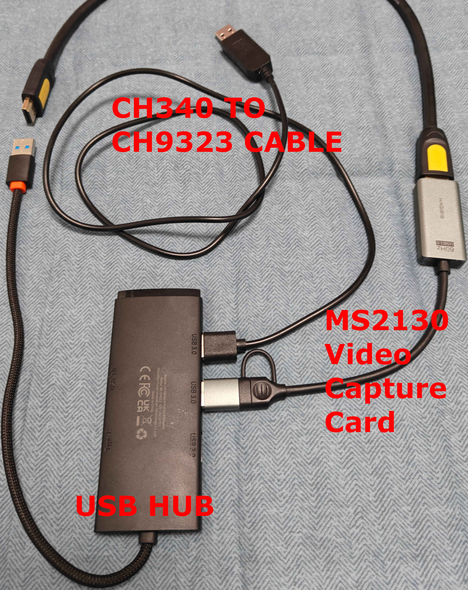

# CH9329 系列

## 硬件清单
1. 视频采集卡： MS2109 或 MS2130 等
2. 串口转 CH9329 的 USB 连接线
3. HDMI 连接线
4. USB HUB （可选）

> 特殊说明：
> 串口转 CH9329 的 USB 连接线在市面上售卖的版本通常是 USB 接 CH340 再转 CH9329 。
> 推荐 CH340 转 CH9329 的连接线是因为在购物平台上有成品可直接购买，比较容易取得。
> 目前市场零售价约20元人民币。
> 如有需要，也可以自行购入使用其他芯片的USB转串口连接线（比如：FT232）然后购买带有串行接口的 CH9329 模块自行连接使用。

## 连接原理图

## 硬件实物图

## 软件连接注意事项

> CH9329 芯片本身可通过软件配置波特率，通常出厂默认设置初始波特率为 9600 ，如波特率选择不匹配芯片设置可能无法正常连接。
> 如无法确定芯片配置或无法正常连接可以使用WCH提供的配置工具恢复出厂设置或重新配置。
> 下载地址： https://www.wch.cn/downloads/CH9329EVT_ZIP.html
> 如需进行测试或重新配置可执行该压缩包内的 CH9329Test_CfgTool.exe

### 其他兼容硬件
此外本项目客户端亦可兼容部分同类型产品，具体信息参考下表。

| 制造商 | 产品名 | 设备类型 |
| --- | --- | --- |
| Sipeed | NanoKVM-USB | CH9329 系列 |
