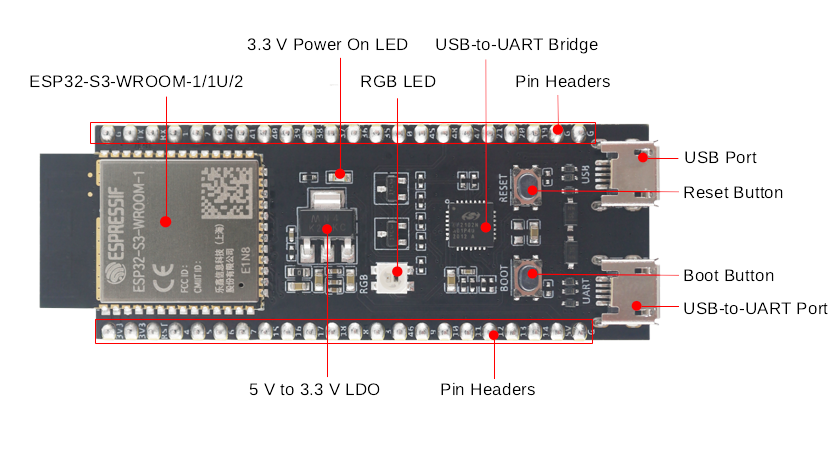
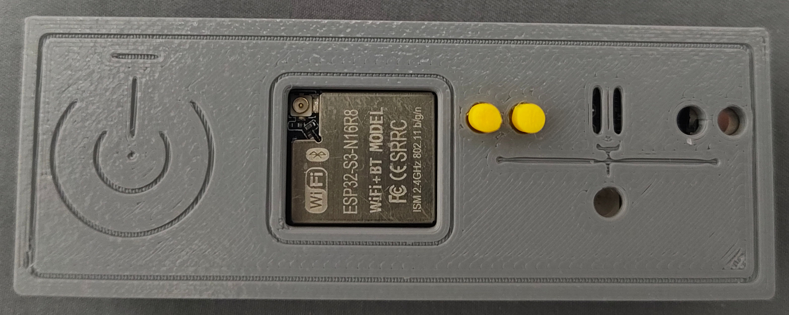
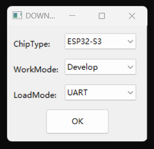
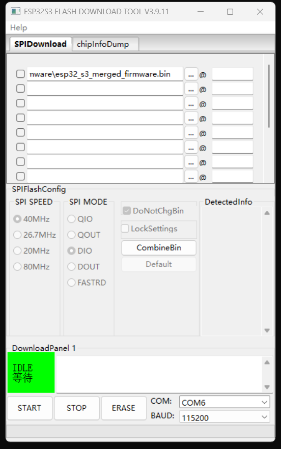

# ESP32 系列

## 简介

ESP32 是由乐鑫信息科技 (Espressif Systems) 开发的一系列系统级芯片 (SoC)。该系列芯片集成了 Wi-Fi 与蓝牙功能，具备成本效益高、功耗低、性能稳定等特点。

## 硬件获取

本项目默认仅支持 ESP32-S3 系列芯片对应的开发板。

此类开发板在各个网上购物平台均可以购买到，售价大约 30 到 40 元人民币。

> [!NOTE]
> ESP32 系列芯片/开发板具有很多版本。
> 
> 乐鑫官方推出的 ESP32-S3 开发板名字为 ESP32-S3-DevKitC-1 。
> 
> 但与此同时市场上具备各种第三方兼容开发板，这些开发板通常基于 ESP32-S3-WROOM-1 制作但可能有不一样的命名比如 ESP32-S3-N16R8 。
> 
> 第三方开发板通常和 ESP32-S3-DevKitC-1 引脚相兼容，固件上也可通用，可以根据个人喜好和需要自行选择合适的开发板。
>
> 第三方开发板可能因为使用CH340/CH343系列的 uart 转换芯片需要安装对应驱动。
> 
> 部分第三方开发板可能需要自行连接开发板上提供的 USB OTG 触点原生接口才可以兼容 USB OTG 。

## 实物参考图片

乐鑫官方参考图片：

硬件实物图（带外壳）：

## 连接方式

控制端为开发板上 USB-to-UART

被控端连接原生 USB port

## 获取固件

最新固件： [esp32_s3_merged_firmware.bin](https://github.com/wevsty/KVM-over-USB/releases/download/v2026.11.01/esp32_s3_merged_firmware.bin)

## 烧录方式

下载并解压乐鑫官方烧录工具 Flash Download Tool（[flash_download_tool.zip](https://dl.espressif.com/public/flash_download_tool.zip)）

将 USB-to-UART 插入 PC 运行 Flash Download Tool 选择主控芯片 ESP-S3 下载接口 UART

选中下载好的固件和对应串行接口后点击 START 即可刷入。

注：烧录固件的方式并非仅此一种，可以根据自己的情况选择使用 IDF 或者 WebUI 等方式刷入固件。

