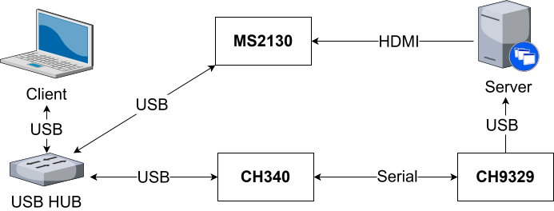
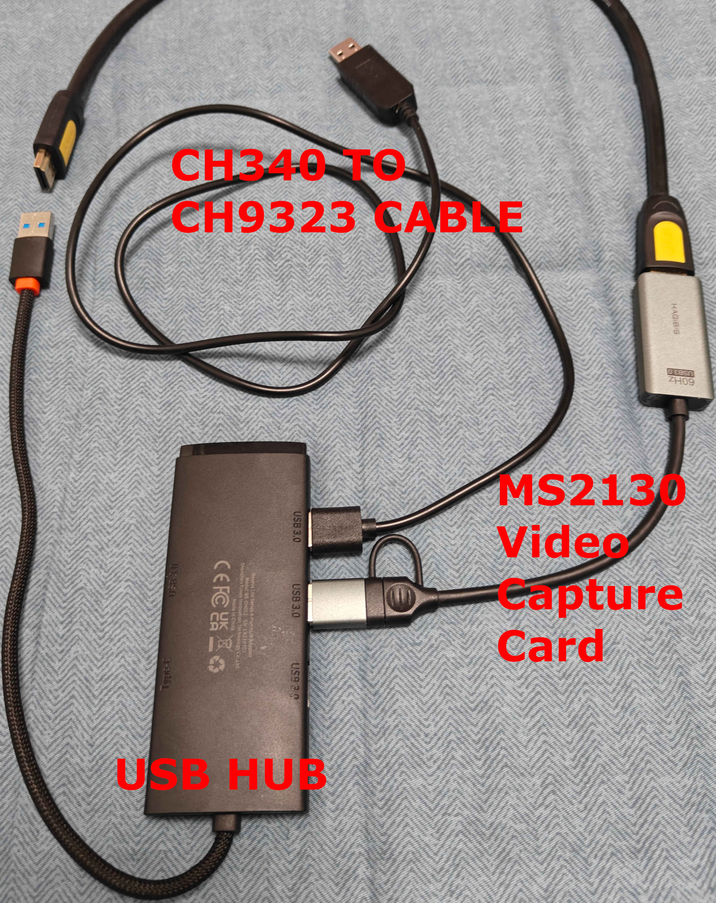

# CH9329 Series

## Hardware List

1. Video capture card: MS2109 or MS2130, etc.
2. USB cable with a serial-to-CH9329 converter
3. HDMI cable
4. USB hub (optional)

> Special notes:
> The USB-to-CH9329 cables sold on the market are usually USB → CH340 → CH9329.
> The CH340-to-CH9329 cable is recommended because finished products can be bought directly on shopping platforms, which makes them easy to obtain.
> The current retail price is about 20 CNY.
> If needed, you can also buy a USB-to-serial cable using another chip (for example FT232) and a CH9329 module with a serial interface, then wire them together yourself.

## Connection Schematic

## Hardware Photos

## Software Connection Notes

> The baud rate of the CH9329 chip can be configured through software. The factory default baud rate is usually 9600; if the baud rate selected in the software does not match the chip settings, the connection may fail.
> If you are unsure about the chip configuration or cannot connect normally, you can use the configuration tool provided by WCH to restore the factory settings or reconfigure the chip.
> Download address: https://www.wch.cn/downloads/CH9329EVT_ZIP.html
> To test or reconfigure the chip, run `CH9329Test_CfgTool.exe` from the downloaded archive.

### Other Compatible Hardware

In addition, the client of this project is also compatible with some similar products. Please refer to the table below for details.

| Manufacturer | Product Name | Device Type |
| --- | --- | --- |
| Sipeed | NanoKVM-USB | CH9329 Series |
