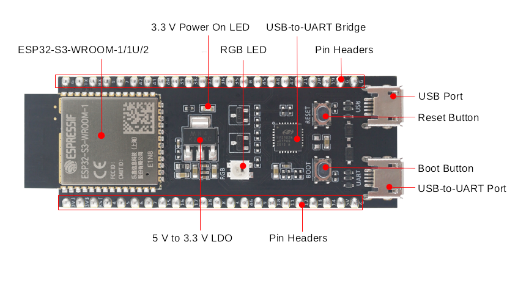
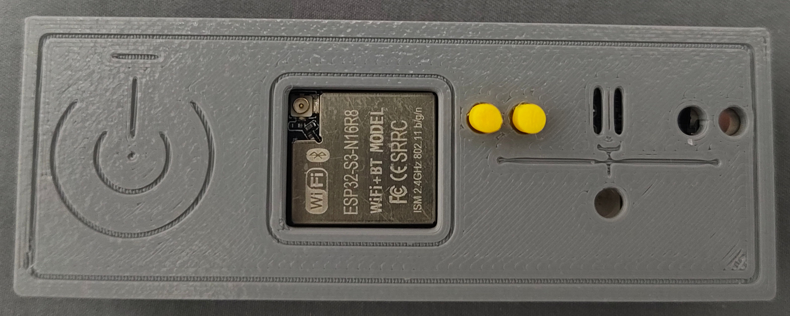
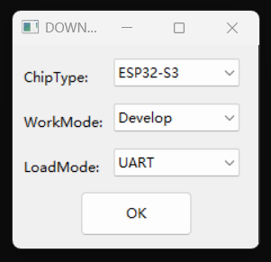
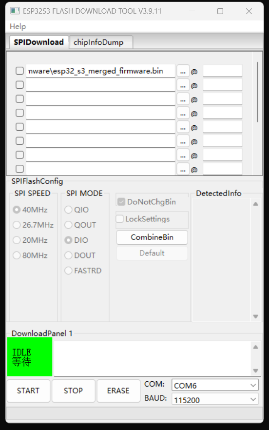

# ESP32 Series

## Introduction

ESP32 is a family of systems-on-chip (SoC) developed by Espressif Systems. These chips integrate Wi-Fi and Bluetooth, and are known for being cost-effective, low-power, and reliable in performance.

## Obtaining Hardware

By default, this project only supports development boards based on the ESP32-S3 series of chips.

Such development boards can be purchased from various online shopping platforms, and typically cost about 30 to 40 CNY.

> [!NOTE]
> The ESP32 series of chips and development boards comes in many versions.
>
> The official ESP32-S3 development board from Espressif is named ESP32-S3-DevKitC-1.
>
> At the same time, the market offers a variety of third-party compatible development boards. These boards are usually built around the ESP32-S3-WROOM-1 module but may carry different names, such as ESP32-S3-N16R8.
>
> Third-party development boards are usually pin-compatible with the ESP32-S3-DevKitC-1 and can use the same firmware, so you can choose a board according to your own preferences and needs.
>
> Third-party development boards may use CH340/CH343 series UART converter chips and therefore require the corresponding driver to be installed.
>
> Some third-party development boards may require you to wire up the native USB OTG pads provided on the board before USB OTG is supported.

## Reference Photos

Official reference photo from Espressif:

Hardware photo (with enclosure):

## Connection

The control side is the USB-to-UART port on the development board.

The controlled side connects to the native USB port.

## Obtaining Firmware

Latest firmware: [esp32_s3_merged_firmware.bin](https://github.com/wevsty/KVM-over-USB/releases/download/v2026.11.01/esp32_s3_merged_firmware.bin)

## Flashing

Download and extract the official Espressif flashing tool, Flash Download Tool ([flash_download_tool.zip](https://dl.espressif.com/public/flash_download_tool.zip)).

Plug the USB-to-UART port into the PC, run Flash Download Tool, and select ESP-S3 as the chip type and UART as the download interface.

After selecting the downloaded firmware and the corresponding serial port, click START to flash it.

Note: This is not the only way to flash the firmware. You can also use IDF or the WebUI, depending on your situation.
