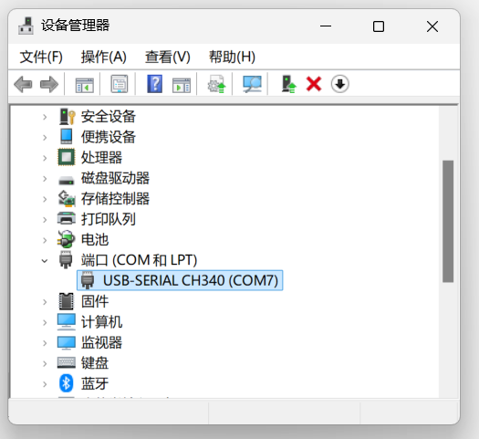
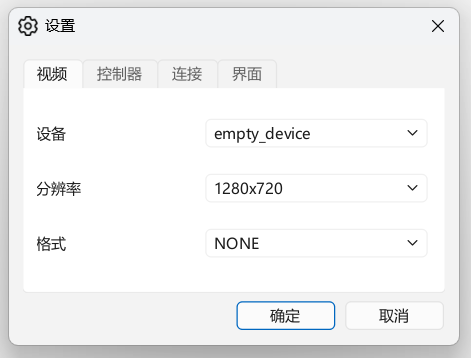
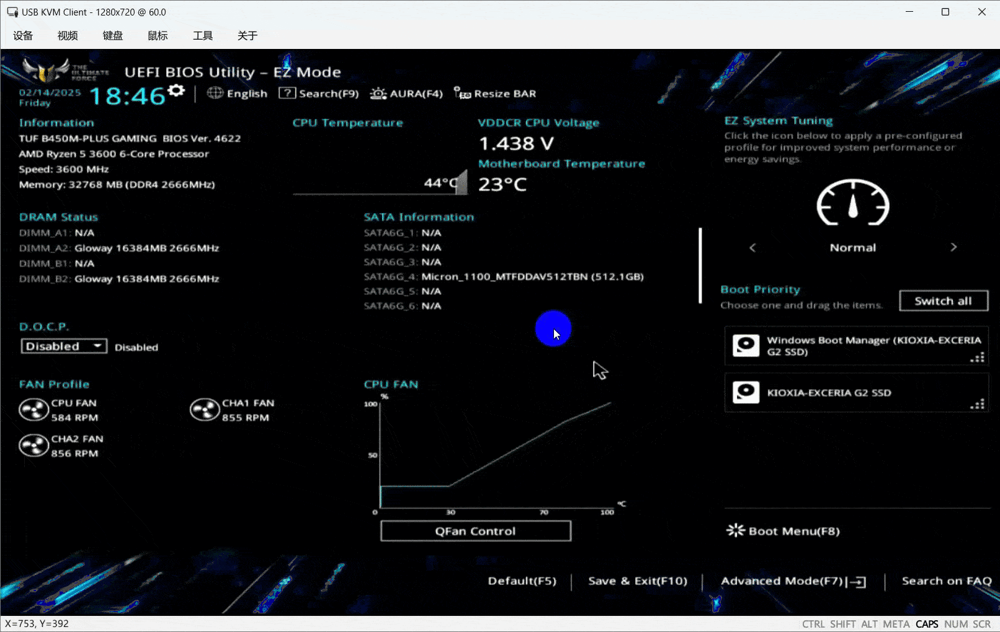
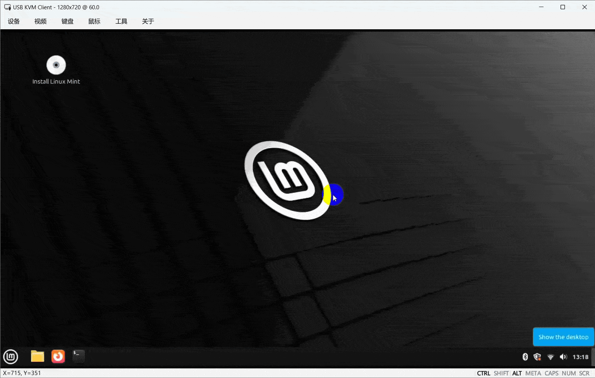

# KVM over USB

[](https://www.python.org)
[](https://github.com/astral-sh/uv)
[](https://github.com/psf/black)
[](https://github.com/wevsty/KVM-over-USB/actions/workflows/code_checks.yml)
[](https://github.com/wevsty/KVM-over-USB/releases)

A simple, open-source KVM-over-USB solution.

📖 Chinese documentation (中文文档): [README.md](https://github.com/wevsty/KVM-over-USB/blob/main/README.md)

## Table of Contents

- [Introduction](#introduction)
- [Features](#features)
- [Hardware](#hardware)
- [Software](#software)
- [Usage](#usage)
- [FAQ](#faq)
- [Credits](#credits)

## Introduction

Restoring a server to normal operation after it loses network connectivity for one reason or another is often very difficult. Although out-of-band management technologies such as IPMI can solve this problem, such equipment is usually expensive and hard for ordinary users to afford.

This project provides some low-cost, USB-based KVM solutions: with nothing more than an ordinary PC connected to the target server over USB, you can remotely manage and maintain the server just as if you were using a local keyboard, mouse, and monitor. This solution is especially well suited to home users and small laboratory environments.

## Features

- Keyboard, mouse, and display control of the target device over USB.
- Support for displaying the video stream from capture devices (webcams / capture cards).
- Support for fast input, automatic input, and clipboard pasting.
- Support for sending keyboard shortcuts (such as `Ctrl + Alt + Delete`).
- Support for a variety of hardware, including CH9329, KVM-Card-Mini, and ESP32-S3.
- Multi-language and multi-platform support.

## Hardware

The project's software already supports CH9329, KVM-Card-Mini, ESP32-S3, and related products. Users can choose suitable hardware based on their own needs and budget.

> [!NOTE]
> This project will do its best to keep the experience consistent across different hardware, but some functions may be limited by the capabilities of the hardware itself.

### CH9329 Series

For details, see the documentation: [CH9329 Series](https://github.com/wevsty/KVM-over-USB/blob/main/documents/EN/CH9329_series.md)

### KVM-Card-Mini Series

For details, see the documentation: [KVM-Card-Mini Series](https://github.com/wevsty/KVM-over-USB/blob/main/documents/EN/KVM-Card-Mini_series.md)

### ESP32 Series

For details, see the documentation: [ESP32 Series](https://github.com/wevsty/KVM-over-USB/blob/main/documents/EN/ESP32_series.md)

## Software

The project's client is based on the source code of [KVM-Card-Mini-PySide6](https://github.com/ElluIFX/KVM-Card-Mini-PySide6), which has been modified and refactored, and adapted to use the CH9329 for keyboard and mouse input.

### Pre-built Client

Please get the pre-built client from the [Releases page](https://github.com/wevsty/KVM-over-USB/releases).

### Building the Client Yourself

Before building, make sure the following dependencies are installed:

- `git`
- `python`
- `uv`

Then run the following commands:

```powershell
git clone https://github.com/wevsty/KVM-over-USB.git
cd client
uv venv
uv sync
# Modify compiler.ps1 according to your actual environment, then run it
./compiler.ps1
```

## Usage

### Windows

#### 1. Connect the Hardware

Connect the hardware to the computer via USB.

> [!NOTE]
> If the USB-to-serial chip in use is a CH340/CH343 or similar, please install the corresponding driver first:
>
> CH340 series driver: <https://www.wch.cn/downloads/CH341SER_EXE.html>
> CH343 series driver: <https://www.wch.cn/downloads/ch343ser_exe.html>
> After the driver is installed successfully, you can find the serial port number in "Device Manager".
> 

Note: If you are using **KVM-Card-Mini series** hardware, no driver installation is required after connecting it to the computer; it is plug-and-play.

#### 2. Configure and Connect

1. Open the client and select the "Device" menu → "Settings".
2. Select the video camera and the controller device.
3. Click "OK" to save the configuration.



Once the configuration is complete, go to the "Device" menu → "Connect" to start using it.

### Linux

The client currently supports common Linux distributions such as Ubuntu.

> [!IMPORTANT]
> Before using it on Linux, you need to pay attention to permission issues.

Taking KVM-Card-Mini as an example, you need to set access permissions for the HID device or grant the program root privileges before use.
It is recommended to set up a udev rule that allows any user to access the HID device provided by KVM-Card-Mini:

```bash
sudo -s
cat > /etc/udev/rules.d/99-kvm-card-mini.rules << EOF
# KVM Card Mini
SUBSYSTEM=="usb", ATTRS{idVendor}=="413d", ATTRS{idProduct}=="2107", MODE="0666"
KERNEL=="hidraw*", ATTRS{idVendor}=="413d", ATTRS{idProduct}=="2107", MODE="0666"
EOF
udevadm control --reload-rules
udevadm trigger
```

After running these commands, reboot or reconnect the device for the changes to take effect.

### macOS

This project has preliminary support for macOS, but it has not been tested yet and no pre-built binaries are provided.

If you need to use it on macOS, please build and run it from the source code yourself.

## Demonstration

Controlling the ASUS BIOS:



Automatic input function:



## FAQ

<details>
<summary><b>Q: What should I do if I encounter a bug in the client?</b></summary>

A: You can enable debug mode from the menu, then describe the problem in an issue and attach the log recorded in debug mode so that it can be analyzed.

</details>

<details>
<summary><b>Q: Why doesn't the mouse work when the controlled end is a Linux distribution?</b></summary>

A: Some operating systems do not support the mouse in absolute coordinate mode. Please try switching to relative coordinate mode for operation.

</details>

<details>
<summary><b>Q: How to send key combinations such as Ctrl + Alt + Delete?</b></summary>

A: To send these key combinations to the controlled end, it is recommended to use the shortcut function in the "Keyboard" menu.

</details>

<details>
<summary><b>Q: What should I do if input behaves abnormally while using the software?</b></summary>

A: Please use the reload or reset function in the software's "Device" menu. If the problem persists after that, it is recommended to try restarting the operating system on the controlled end.

</details>

<details>
<summary><b>Q: How should I handle incorrect letter case when fast-pasting or using clipboard input?</b></summary>

A: Please first synchronize the keyboard state using the "Sync indicator" function in the menu, then try again.

</details>

## Credits

- [Jackadminx](https://github.com/Jackadminx) / [KVM-Card-Mini](https://github.com/Jackadminx/KVM-Card-Mini)
- [ElluIFX](https://github.com/ElluIFX) / [KVM-Card-Mini-PySide6](https://github.com/ElluIFX/KVM-Card-Mini-PySide6)
- [binnehot](https://github.com/binnehot) / [KVM-over-USB](https://github.com/binnehot/KVM-over-USB)
